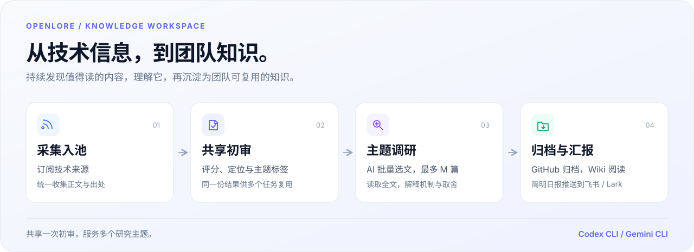
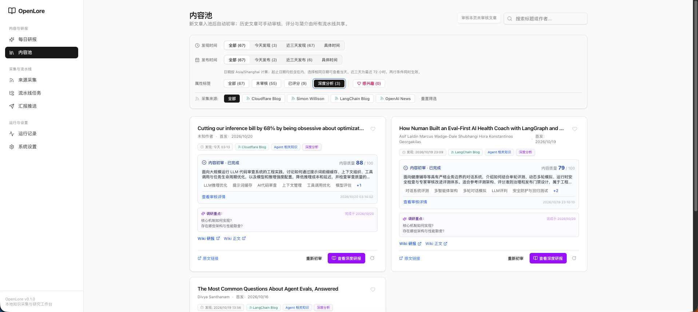

# OpenLore

面向个人与团队的技术知识工作台，把持续涌入的信息，变成可阅读、可追溯的深度研报。

[快速开始](docs/guides/getting-started.md) · [功能总览](docs/product/feature/index.md) · [完整文档](docs/README.md)

## 能做什么

- **持续发现**：订阅技术来源，采集正文，统一进入内容池。
- **按主题研究**：共享初审评分与摘要，AI 批量选文，按需深度调研。
- **沉淀与分享**：文章和研报归档到 GitHub，通过 Wiki 阅读，向飞书 / Lark 推送简明汇报。
- **过程可查**：初审、选文、调研与推送记录集中查看，追踪 AI 输入、输出和执行状态。

## 界面一览

内容池串起原文、质量评分、主题标签与深度研报。

## 如何运行

## 开始使用

| 你想做什么           | 从这里开始                                       |
| -------------------- | ------------------------------------------------ |
| 了解日常使用流程     | [首次使用](docs/guides/getting-started.md)       |
| 部署网站             | [控制服务部署](docs/guides/server-deployment.md) |
| 接入自己的 AI 执行器 | [AI Runner 接入](docs/guides/ai-executors.md)    |
| 本地开发与调试       | [开发者指引](docs/guides/development.md)         |

架构与运行边界见[系统架构](docs/architecture/system-architecture.md)。
