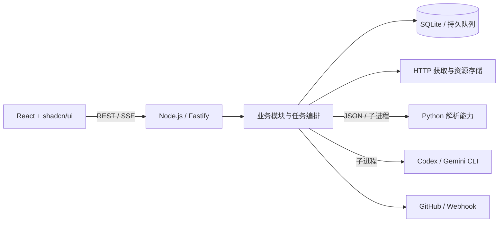

# 前后端架构与技术选型

状态：已确定，作为首期实施基线；尚未创建工程或验证运行。日期：2026-10-15。

**React + shadcn/ui 构建前端，Node.js + Fastify 承担主服务，Python 复用采集解析生态，SQLite 保存状态与队列。**采用模块化单体，通过明确协议接入其他语言能力。

产品行为以[功能总览](../product/feature/index.md)为准；本文统一技术栈、工程结构与语言边界，取代此前 Python/FastAPI + Jinja2/HTMX 的主服务方案。

## 1. 确定的技术栈

| 范围 | 选型 | 用途与理由 |
| --- | --- | --- |
| 前端 | React 19 + TypeScript + Vite | 本地工作台采用 SPA；无需 SEO 或服务端渲染，构建产物可直接随主服务分发 |
| UI | shadcn/ui（Radix 基础组件）+ Tailwind CSS 4 + Lucide | 直接维护组件源码，用按钮、表单、弹层、表格等原子能力组合业务界面 |
| 路由与数据 | React Router 7 Declarative 模式 + TanStack Query 5 | 路由负责页面导航；Query 负责 API 数据、缓存和失效刷新 |
| 表单与契约 | React Hook Form + Zod 4 | 统一输入结构和前后端校验；后端始终重新验证 |
| 主服务 | Node.js 24 LTS + TypeScript + Fastify 5 | 统一 API、任务编排、文件处理和子进程生命周期 |
| Python 能力 | Python 3.12 + uv；feedparser + Trafilatura | RSS/Atom 解析及正文提取，首期以本地子进程接入 |
| 数据 | SQLite WAL + Drizzle ORM + better-sqlite3 | 单机持久状态与任务队列，无需额外数据库服务；迁移由 Drizzle Kit 管理 |
| 通信 | REST JSON + SSE；跨语言使用 JSON 协议 | REST 处理操作，SSE 通知状态变化；跨语言协议不依赖框架对象 |
| 工程 | pnpm workspace、ESM、TypeScript strict、ESLint、Prettier | 前端、Node 主服务与共享契约同仓管理；Python 使用独立 uv.lock |
| 验证 | Vitest、React Testing Library、Playwright；Python pytest | 分别覆盖业务规则、组件交互、完整流程和解析样本 |

Node 24 属于 LTS 发布线，采用该线维护版本，依据 [Node 发布计划](https://nodejs.org/en/about/previous-releases)。初始化时固定具体依赖版本并提交 pnpm-lock.yaml、uv.lock；pnpm 版本写入 packageManager，Node/Python 版本写入环境配置。默认采用正式稳定版，不因文档示例使用预发布依赖。

## 2. 整体运行方式



- 首期单机单用户，生产环境只有一个 Node 主服务监听 `127.0.0.1:8767`，同时提供 API、SSE 与前端静态文件。关闭网页后任务继续运行。
- 前后端分目录开发、一起发布；Vite 开发服务器代理 `/api` 至 Node。生产环境通过 `@fastify/static` 托管页面，SPA 回退只处理页面路由，未知 API 返回 JSON 404。
- 调度器和任务执行循环随主服务启动；Python 与 AI 按任务启动子进程，完成后退出。数据库租约和幂等记录仍是任务状态依据。
- SQLite、材料、任务目录和凭据继续存放在 `~/.openlore/`。启动、备份、休眠恢复及并发规则见[本地服务设计](../design/local-service-and-ai.md)。

## 3. 前端边界与组件规则

shadcn/ui 提供可组合、可修改的组件源码，适合建立本项目自己的组件层；官方已有 [Vite 接入方式](https://ui.shadcn.com/docs/installation/vite)与[组件设计说明](https://ui.shadcn.com/docs)。

- `components/ui/`：按需引入 shadcn/ui 原子组件，统一使用 Radix 版本；保持焦点管理、键盘操作与可访问标签，不放 API 请求和业务规则。
- `components/`：跨页面组合组件，例如状态徽标、确认操作、分页列表；业务专属组件放入对应 `features/`。
- `features/`：按设置、来源、采集组、运行、内容库、调研组织页面、查询与表单；页面通过统一 API 客户端访问主服务。
- 颜色、间距和圆角通过 CSS variables 与 Tailwind token 统一。表单提供字段错误，页面提供加载、空数据、失败和重试状态；不重复手写已有基础组件。
- 服务端数据归 TanStack Query；筛选、分页进入 URL，临时交互状态使用 React 本地状态，首期不增加 Redux/Zustand。表单采用 [shadcn/ui + React Hook Form](https://ui.shadcn.com/docs/forms/react-hook-form)。
- Markdown 展示使用 react-markdown + remark-gfm，关闭原始 HTML，限制链接和资源协议；原文、AI 导读及错误信息都按不可信内容呈现。

## 4. Node 主服务边界

主服务按业务模块组织为 `routes → service → repository/adapter`：路由做协议转换，service 执行业务规则，repository/adapter 处理数据库与外部能力。依赖在启动入口装配，业务模块不依赖 Fastify 请求对象。

| 模块 | 主服务负责的内容 |
| --- | --- |
| settings / sources / groups | 配置、连接、来源与组规则；凭据仅在服务端解析 |
| scheduler / jobs | 到期计划、持久入队、互斥租约、重试、取消和恢复 |
| collection | HTTP 获取、条件请求、解析调用、条目映射、去重与续采状态 |
| processing / research | 筛选、AI/skill 执行编排、证据校验、产物生成 |
| delivery | 固定文件包、GitHub 同步、冲突处理和通知 |

- API 不等待长任务执行；操作先完成持久入队，返回 `202 + run_id/job_id`。同一在途运行去重，刷新页面后仍可查询状态。
- SQLite 只有 Node 写入；启用 WAL、外键和 busy_timeout。数据库事务保持短小，HTTP、Python 和 AI 调用均在事务外执行；迁移成功后才启动调度。
- better-sqlite3 为同步驱动，查询须分页并限制批量，禁止在请求路径中扫描全部正文。原生模块安装要纳入 macOS/Linux 环境验证；Drizzle 的驱动支持见[官方文档](https://orm.drizzle.team/docs/get-started-sqlite)。
- 日志使用 Fastify/Pino，带 request_id、run_id、job_id 并统一脱敏。优雅退出时停止领取新任务，再处理在途任务和子进程；崩溃由租约恢复。

## 5. 多语言接入：首期 Python 子进程

**允许多语言，但业务状态、调度和对外 API 只有一个入口。**首期保留 Python 是为了复用 [feedparser](https://feedparser.readthedocs.io/en/latest/introduction/) 与 [Trafilatura](https://trafilatura.readthedocs.io/en/latest/usage-python.html)；两者均可解析主服务提供的材料，无需另起 FastAPI 服务。

1. Node HTTP 层负责下载、重定向检查、超时、大小限制、ETag/304 与原始材料落盘；Python 只解析传入的 Feed/HTML，不自行联网、写业务数据库或推进来源检查点。
2. Node 以参数数组、`shell: false` 启动固定 Python 可执行文件，执行 `-m openlore_collectors`。stdin 传一个 JSON 请求，stdout 只返回一个 JSON 结果，日志走 stderr；任务结束即退出。
3. 请求包含 `protocol_version=1`、job_id、operation（`parse_feed` / `extract_article`）、任务目录内的 input_path、原始/最终 URL、必要响应元信息与解析选项。结果包含同版本、job_id、status、data、issues、error；错误携带 code 和 retryable。解析数据经 Node 适配器映射为 [CollectionResult](../design/collection-adapters.md)，不暴露 Python 库对象。
4. 解析子进程默认并发 2、单次超时 30 秒、stdout 上限 16 MiB；HTML/Feed 输入单次上限 10 MiB。超限或输出非法显式失败，不截断后标为成功；预算可配置。
5. 进程退出码、协议版本、JSON 结构和业务结果全部通过校验才接收。超时/取消终止本任务进程组；子进程崩溃只影响当前任务，重试由 Node 队列统一决定。
6. Python 使用 uv 管理独立环境与锁文件。安装阶段准备依赖，常驻运行使用已验证的解释器绝对路径，不临时安装包；不向解析进程传入 Token、Webhook 或完整主服务环境。

跨语言消息的 Zod schema 放在 `packages/contracts/`，生成 JSON Schema 分发给 Python，使用 `jsonschema` 验证；CI 检查生成物与共同样本。协议只使用 JSON 可表示类型，业务语义校验留在 Node。导出方式见 [Zod JSON Schema](https://zod.dev/json-schema)，环境管理见 [uv 项目文档](https://docs.astral.sh/uv/guides/projects/)。

以后新增 Go/Rust/Python 能力仍通过 adapter 接入。仅在需要独立部署、专用设备或持续运行时再转为 HTTP 服务；届时明确鉴权、超时和协议版本，主服务业务接口保持一致。

## 6. 前后端契约与本地访问

- API 统一放在 `/api/v1`；共享 Zod DTO、错误码和事件结构，前端不导入数据库模型或服务端实现。Fastify 在请求边界执行 Zod 校验，响应显式转换为 DTO。
- 错误统一为 `{error: {code, message, details?}, request_id}`，HTTP 状态区分参数错误、冲突、不可用及内部错误；禁止返回凭据或内部堆栈。
- SSE 只推送实体 ID、状态与修订号，前端收到后使对应 Query 失效并重新获取；首次连接、断线重连和恢复页面焦点时查询当前快照。数据库是事实来源，SSE 不承担可靠任务投递。
- 本地 UI 使用 HttpOnly、SameSite=Strict 会话 Cookie；修改操作校验 Origin 与 CSRF token，服务校验 Host 白名单，默认关闭跨域。开发时走 Vite 同源代理。
- 采集 URL 与每次重定向都执行公开 HTTP(S) 地址检查，阻止内网与本机目标；下载资源、仓库 Token 和 CLI 调用均由主服务控制。

## 7. 工程目录

```text
apps/
├── web/src/
│   ├── app/                    # 路由、Provider、整体布局
│   ├── components/ui/          # shadcn/ui 原子组件
│   ├── features/               # 六个业务页面模块
│   └── lib/                    # API 客户端、通用前端工具
└── server/src/
    ├── cli/                    # serve / doctor / service
    ├── http/                   # Fastify、REST、SSE、静态资源
    ├── modules/                # settings、sources、groups、jobs 等业务模块
    └── infrastructure/         # SQLite、HTTP、Python、AI、GitHub、通知
packages/contracts/             # DTO、Zod schema、跨语言 JSON Schema
workers/python/
├── src/openlore_collectors/     # 进程入口、Feed 解析、正文提取
├── tests/                      # 固定 Feed/HTML 样本与协议测试
├── pyproject.toml
└── uv.lock
```

首期不建通用插件平台，也不额外引入 Next.js、微服务、Redis/BullMQ、Docker 或桌面壳。Vite 负责页面构建，Fastify 负责本地长期任务，SQLite 负责单机持久化；新增基础设施应由具体容量或部署需求推动。

## 8. 实施顺序与验收

1. **工程骨架**：pnpm workspace、Node API、React/shadcn 页面框架、共享契约、SQLite 迁移和 Python 环境。构建后从 Node 打开六个页面，直接刷新路由可用，doctor 能发现依赖缺失。
2. **采集闭环**：设置/来源/组 → Node 下载 → Python 解析 → 持久化 → 运行页。用 Cloudflare、Simon 的真实来源和固定样本验证 RSS/Atom、304、代码/图片引用保留、失败与重启续采。
3. **处理与交付**：沿既有协议接入本地 AI、证据与资源处理、文件包、GitHub 和通知；前端能看到进度、错误、取消与重试。
4. **自动化与恢复**：完成常驻、休眠补跑、Python 超时/非法输出、AI 失败、SSE 重连、Git 冲突和通知补发验收。

初始化时提供 `pnpm dev/build/lint/typecheck/test/test:e2e`；Python 测试用 `uv run --locked pytest`（在 workers/python 下执行）。CI 执行静态检查、构建、Node/Python 契约测试及关键端到端流程；真实 AI 与外部写入使用显式配置的测试环境验收。
