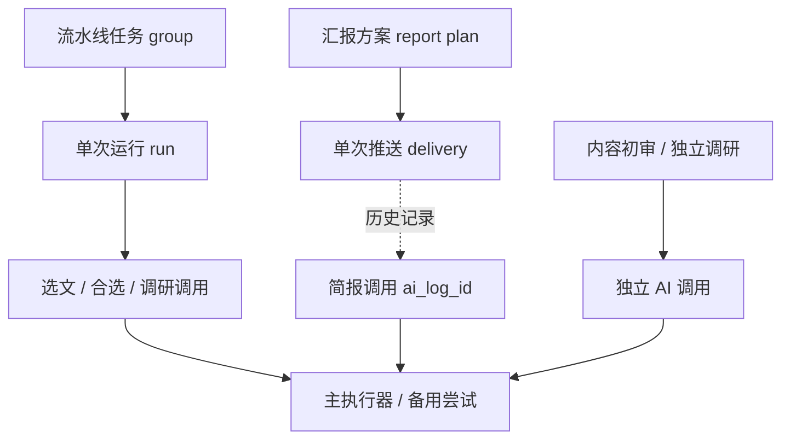

# 07 运行记录与 AI 调用追踪

运行记录以业务执行为主线，固定三个页签：**流水线任务、推送日志、AI 调用日志**。默认打开流水线任务。页签、运行范围及打开的调用 ID 写入 URL，刷新和浏览器前进后退可恢复位置。

## 流水线任务

每张卡片代表一次运行（run），保留阶段、起止时间、文章统计、错误、GitHub 归档、选文结果及调研摘要。支持按流水线任务筛选。

在卡片内展开“本次运行的全部 AI 调用”，直接查看本次批量选文、分批合选和调研调用；支持搜索、状态/类型过滤、分页。点击调用打开统一详情，包含完整输入、输出、时限、耗时和每次主备尝试，不跳离运行卡片。

内容初审独立于流水线记录，不冒填 `run_id`。流水线复用初审结果时不会产生新的初审调用。主备切换属于同次调用的多个 attempt；正文证据重试产生另一条初审记录。

## 推送日志

每条记录展示汇报正文、目标通道、成功/失败、回执及关联任务。当前汇报按配置模板直接渲染，不调用 AI；已有历史记录中的简报调用仍可查看。

当前推送不生成 `ai_log_id`。历史 AI 推送可通过 `deliveries.response_json.ai_log_id` 查看精确调用 ID。历史推送没有该字段时，可按已保存的批次 job ID 查询批次调用，并明确提示历史缺失。结构化汇总不调用 AI。

## AI 调用日志

提供跨任务的调用检索，可按以下类型筛选：

| 类型       | task_type         | 内容                                                               |
| ---------- | ----------------- | ------------------------------------------------------------------ |
| 内容初审   | `assess`          | 关联文章，查看全文材料、质量分、定位、简介、证据和错误             |
| 流水线选文 | `select`          | 关联运行，查看完整候选列表、入选 ID 与理由；分批及最终合选各自记录 |
| 深度调研   | `research_report` | 关联文章与运行，查看调研要求及研报输出                             |

每条调用显示来源：流水线运行、汇报推送或独立调用。点击来源返回业务页签，并定位关联运行或方案。独立调研可关联学习主题，但不伪装为某次流水线运行。

三个入口复用相同的调用列表、详情组件和接口；调用只有一份持久化记录。列表按需加载摘要，详情再获取完整文本，避免将所有 Prompt 和文章随运行列表传输。

## 关联模型

- 流水线调用：`group_id` 标识主题任务，`run_id` 精确标识某次运行。
- 简报调用：`report_plan_id` 标识汇报方案；不复用流水线 `group_id`，也不冒填 `run_id`。
- 调用：`ai_execution_logs.id` 是统一详情的唯一 ID；`job_id` 是应用执行任务 ID。
- 尝试：每次主备执行记录在同一调用的 `attempts` 中，保留各自时限与结果。
- 推送：`ai_log_id` 关联本次简报生成，`pipeline_ids` 标识汇总了哪些任务。

接口 `GET /execution-logs` 按 `run_id`、`job_id` 或 `log_id` 精确筛选，再叠加搜索、状态、类型及分页；详情始终使用 `GET /execution-logs/:id`。接口沿用管理认证与日志脱敏。
