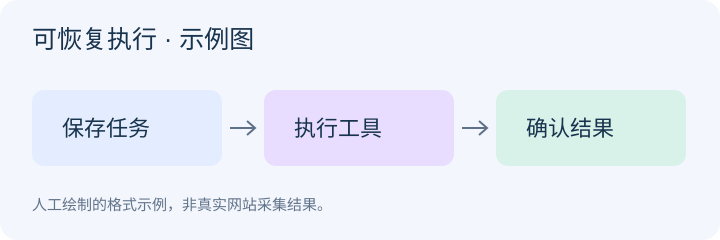

# AI 调用工具超时后，为什么不能直接重试

> 人工构造的阅读示例，未执行真实调研、代码运行或性能测试。仅以[本篇虚拟原文](article.md)为研究主体，以下订单场景是假设例子。

AI 调用工具后没有收到回复，不代表工具没有完成操作。如果立即重试，就可能把同一件事做两遍。原文建议保存任务进度，超时后先查询结果；这对会修改外部数据的工具尤其重要。

## 先看一个订单例子

假设 AI 发出创建订单的请求，商店已经生成订单，回复却在途中丢失。AI 只看到“请求超时”，如果再创建一次，就可能多出一个订单。

较稳妥的做法是先保存这次请求的固定编号，超时后按编号查询：已经完成就记录结果，确认未执行再考虑重试；查不到结果时，也不能直接断定没有执行。这是对原文思路的设计推断，需要目标系统支持按编号查询或识别重复请求。

## 保存进度能解决什么

[原文](article.md)提出：执行前保存输入、任务标识和状态，成功后保存结果，重启时先读取这些记录。这里的“任务标识”就是区分每次任务的固定编号；“持久化”是把记录保存到程序重启后仍能读取的存储中。

下图从左到右说明原文中的三个步骤，箭头表示执行顺序。它展示正常完成的过程，超时后的结果核对还需要额外处理。

由此可以进一步建议，把“请求已发出”“目标系统确认完成”“本地已保存结果”分开记录。这样程序重启后，才能判断下一步是查询外部结果，还是读取已经保存的结果。这个建议并未经过实际代码验证。

## 还需要目标系统配合

本地保存了任务编号，不代表商店系统也认识这个编号。只有目标系统支持按编号查询，才能据此核对订单；如果它还能识别重复编号，让同一请求重复发送也不会再次创建订单，就提供了这里需要的“幂等”保证。

如果目标系统既不能查询，也不能识别重复请求，结果仍可能不确定。这时需要人工核对或其他业务处理方式，不能声称仅靠保存进度就能安全重试。

## 可以先验证什么

建议模拟“操作已完成、回复丢失”和“本地保存结果前重启”这两种情况，检查程序会查询、重试还是等待人工处理，并确认是否出现重复操作。本文没有执行这些验证，也没有效果数据。

参考材料只有[本篇虚拟原文](article.md)，没有外部扩展资料。

[返回文章](article.md) · [返回采集批次](../../batches/20261015-01.md)
