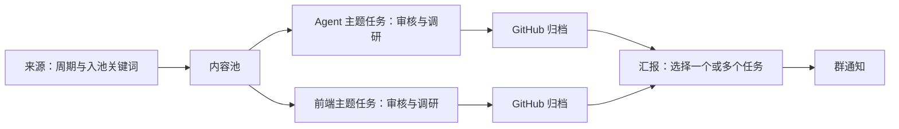

# OpenLore 功能与流程

**来源采集 → 内容池 → 流水线任务 → 汇报推送**。

| 菜单 | 路由 | 职责 |
| --- | --- | --- |
| 每日精选 | `/` | 阅读精选与调研结果 |
| 来源采集 | `/sources` | 配置采集周期、关键词与启用状态，独立入池 |
| 内容池 | `/pool` | 按首次入库时间查看全部文章 |
| 流水线任务 | `/pipelines` | 按主题进行 AI 审核、调研与 GitHub 归档 |
| 汇报推送 | `/reports` | 建立多个汇报方案，分别汇总任务、生成简报并发送到不同群 |
| 运行记录 | `/runs` | 查看任务阶段、AI 日志、错误及推送记录 |
| 系统设置 | `/settings` | 管理仓库、AI 执行器、通知通道与系统诊断 |

来源与任务独立调度。任务从最近 N 天入库的未精选文章中全量评估，再精选和调研。汇报等待所选任务完成 GitHub 归档后，合并结果发送。

- [01 来源采集](01-source-management.md)
- [02 流水线任务](02-group-pipeline.md)
- [03 AI 技能与处理](03-ai-skills-and-processing.md)
- [04 每日精选](04-homepage-daily-feed.md)
- [05 GitHub 归档](05-git-delivery-and-archive.md)
- [06 汇报推送](06-reporting.md)
