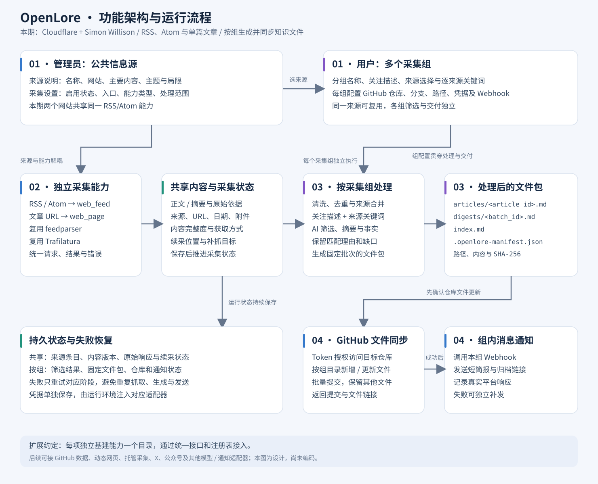

# OpenLore：本地知识采集与研究工作台

**一次配置连接，按组配置路由；本地服务持续发现文章，用自己的 Codex/Gemini 处理，再将原文、分析和调研报告写入 GitHub。**

本目录是当前产品方案。表内默认值用于直接推进实现；来源/CLI 的访问记录不等于产品已经实现，真实运行仍按下方验收。

[单独查看 SVG](assets/system-architecture.svg)

## 用户如何开始

1. 启动本地服务，打开设置：保存 GitHub 仓库与 Token，选择已登录的 Codex/Gemini，完成一次测试；可选保存通用 Webhook。
2. 在来源页查看 Cloudflare、Simon 的内容说明，预览并启用来源。
3. 创建“Agent 相关知识”组，选择两个来源并填写关键词；选择已保存仓库，路由填 `/docs/agent-leaning`。
4. 预览计划后立即运行：看到发现、去重、候选、入选、失败与延后数量，并能查看每篇的理由。
5. 在批次目录阅读整理后的文章及本地图片；勾选逐篇研究后，research.md 随后补齐到各文章目录。
6. 开启常驻与定时，关闭网页后仍运行；睡眠、网络或额度中断时保留状态，恢复后继续。

## 四项功能与确定默认值

| 功能 | 方案入口 | 本期明确行为 |
| --- | --- | --- |
| 配置 | [01](01-source-configuration.md) | 工作区保存仓库/通知/AI；管理员维护来源，用户的组引用连接并配置路由 |
| 采集 | [02](02-content-collection.md) | RSS/Atom + 文章 URL；每 30 分钟发现，组默认每日 09:00 运行；首次近 7 天，每批评估 20 篇 |
| 处理与研究 | [03](03-content-processing.md) | relevance ≥70、quality ≥50，最多入选 10 篇；Codex/Gemini 任选；组规则勾选逐篇研究，唯一主文章 + 最多 6 个引用页；分类与整理通过 skills |
| 文件同步 | [04](04-delivery-and-git-archive.md) | 日期批次/文章目录；article.md 与 assets 必备，research.md 与 digest.md 按组开关生成 |

参数可配置，规则必须可解释。空批次零文件、零空提交；积压不当作排除；同一文章可被多个组独立处理。

## 查看一个真实形态的产物

[仓库样例：/docs/agent-leaning](examples/README.md) · [工作区与两个组的配置样例](examples/workspace-config.json)。样例文章为虚拟材料，未调用模型或写入远端。

示例采用 `20261015-01/01-agent-recovery/article.md`，同目录放 research.md 和 assets。两篇各一张图：基础产物 7 个文件，简报与逐篇研究全部完成时 10 个；重跑无变化不提交。

## 运行与页面

单机单用户，React + shadcn/ui 前端、Node.js/Fastify 主服务、Python 采集解析子进程与 SQLite 持久队列。技术栈和工程边界见[架构选型](../../architecture/technology-stack.md)。导航为设置、来源、采集组、运行、内容库、调研；管理员与普通使用者在首期是同一人承担的职责。

细节：[本地服务与 AI](../../design/local-service-and-ai.md) · [采集协议](../../design/collection-adapters.md) · [处理/文件同步协议](../../design/processing-and-delivery.md)。每项基建独立目录，业务只依赖统一接口。

## 分阶段落地与验收

| 阶段 | 交付与通过条件 |
| --- | --- |
| A：可配置、可采集 | 本地设置/来源/组页面，保存连接与路由；两源解析及真实正文读取；数量示例、304 和重启续采通过 |
| B：可分析、可归档 | 两个 CLI 适配器各做一次真实验证；生成示例形态文件，Token 写入测试仓库；重跑无重复、更新路径稳定 |
| C：可研究、可常驻 | 手动和勾选后的逐篇研究均遵守预算；图片完整、同篇报告就近归档；后台启动、睡眠补跑、额度暂停与恢复通过 |
| D：完整故障验收 | 两组隔离、来源超时、非法模型输出、远端冲突、提交结果不明和消息补发，均在页面显示且能恢复 |

四个阶段完成才算本期交付。实施前一次性准备真实仓库/Token、所选 CLI 登录、可选 Webhook；工程选择已有默认方案，运行时故障通过明确状态和操作解决，不靠临时询问补业务逻辑。
