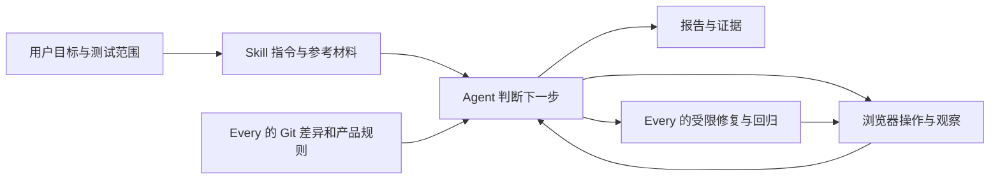

# Dogfood 核心逻辑拆解

核查：2026-11-10。基线与验证范围见[调研索引](README.md)。

**两者都把测试策略写成 Agent 可执行的工作流。测试路径和缺陷判断主要由模型完成，浏览器负责真实操作与取证；没有发现一个随 Skill 附带、强制执行所有阶段的测试调度器。**

## 1. 共同的运行结构

这里的自动化来自宿主 Agent 的工具调用。Markdown 规定顺序与边界；实际遵守程度仍取决于宿主、模型和工具可用性。Every 附带的 Python 脚本只解析产品规则包，**不驱动浏览器、不自动判断测试是否通过**。

## 2. Vercel：观察 → 探索 → 复现 → 交付证据

入口：[dogfood/SKILL.md](../../../skills-reference/test-dogfood/dogfood/SKILL.md)。

| 阶段 | 实际逻辑 | 关键作用 |
| --- | --- | --- |
| 初始化 | 接受 URL，建立命名会话和输出目录，复制报告模板 | 只给网址也能启动，源码不是必需输入 |
| 登录 | 通过页面登录，必要时等待验证码，保存会话状态 | 让后续路径能保持身份；状态文件可能包含登录信息 |
| 建立地图 | 截图并读取交互元素，从主导航识别页面结构 | 由实际页面构建探索入口 |
| 探索 | 操作按钮、表单、导航；尝试空值、边界和完整流程，检查控制台 | 用分类清单引导模型寻找异常 |
| 复现与取证 | 至少重试一次；交互问题录视频并逐步截图，静态问题单张截图 | 给每个缺陷提供可交接的重现依据 |
| 收尾 | 校对严重度数量，关闭会话，交付报告 | 汇总必须与实际缺陷条目一致 |

[分类清单](../../../skills-reference/test-dogfood/dogfood/references/issue-taxonomy.md)覆盖 UI、功能、体验、内容、性能、控制台和无障碍，并列出页面探索检查项。它提供观察方向，没有实现性能采样器或完整无障碍扫描器；其中时间阈值只是清单提示，不能当成性能测试结果。

[报告模板](../../../skills-reference/test-dogfood/dogfood/templates/dogfood-report-template.md)要求每项有严重度、分类、URL、实际与预期、重现步骤及证据路径。缺陷一发现就写入，降低长任务中断造成的信息丢失。

**核心策略是“先证明问题，再交接问题”。** 页面路径、预期行为和严重度主要依赖 Agent 判断；没有强制先建立完整用例矩阵。正文禁止读取被测应用源码，但允许用浏览器的页面快照观察运行界面。这是黑盒边界，不是禁止一切页面结构信息。

浏览器能力来自外部 `agent-browser`：交互快照给出可操作元素引用，截图补充视觉信息；导航或元素替换后要重新取快照。录屏保存操作过程，**不自动生成可执行的回放脚本**。[官方快照文档](https://agent-browser.dev/snapshots)、[录屏文档](https://agent-browser.dev/recording)。

## 3. Every：差异 → 旅程 → 矩阵 → 执行 → 修复验证

入口：[ce-dogfood/SKILL.md](../../../skills-reference/test-dogfood/ce-dogfood/SKILL.md)，执行细节：[phases.md](../../../skills-reference/test-dogfood/ce-dogfood/references/phases.md)。

| 阶段 | 实际逻辑 | 关键作用 |
| --- | --- | --- |
| 0：范围与隔离 | 解析 PR / 分支 / 当前分支；其他目标交给 ce-worktree；查找未完报告 | 明确测哪份代码，避免直接切换用户主工作区 |
| 1：分析 | 读取 Git 差异、产品文档、人物画像与 Compound Packs | 同时理解改了什么、谁使用、正确行为是什么 |
| 2：建模 | 先画 Mermaid 用户旅程，再推导场景矩阵和任务列表 | 检查完整业务结果，不能只测孤立控件 |
| 3：准备环境 | 优先能覆盖矩阵的宿主内置浏览器，否则使用 agent-browser；确认服务来自目标工作区 | 选择执行工具并对齐被测服务 |
| 4：执行 | 逐场景走完整旅程，检查界面、控制台、规则和画像体验 | 功能通过的场景仍可记录体验摩擦 |
| 5：修复 | 只自动处理小且明确的问题；补回归、提交、再测；大决策记为阻塞 | 修复结果必须回到原失败场景验证 |
| 6：报告 | 运行项目自动化套件一次，完成报告并提交；保留阻塞和未证明部分 | 浏览器矩阵全绿不能掩盖自动化套件失败 |

[测试维度](../../../skills-reference/test-dogfood/ce-dogfood/references/test-matrix-taxonomy.md)把业务链路拆成入口、动作、结果、落点和后续副作用。例如“邮件已发送”还不够，要检查接收人、链接落点和正确内容。文件到页面的映射是供模型推导的规则，未附自动构建依赖图的分析器。

持久报告在矩阵建立时创建。恢复时，`Pass / Fixed / Skipped` 保持完成，`Pending / in_progress` 继续，两个 `Blocked` 状态留待人工处理；这些恢复动作由 Agent 阅读报告后执行。[报告模板](../../../skills-reference/test-dogfood/ce-dogfood/references/dogfood-report-template.md)包含旅程图、矩阵、根因、回归、规则符合性、体验摩擦、人工验证和最终就绪结论。

画像体验检查包括模型从用户角度推演摩擦感，不能视为真实用户研究。外部邮件、支付等优先使用本地替身；改动涉及而替身不能覆盖的部分要标为待人工验证，不据此宣称真实链路已验证。

## 4. Every 的唯一附带脚本究竟做什么

[packs-resolve.py](../../../skills-reference/test-dogfood/ce-dogfood/scripts/packs-resolve.py)将项目声明的规则包定位成可读目录，供 Agent 在测试时使用：

1. 读取 `.compound-engineering/config.yaml` 和 `config.local.yaml` 的 `packs`，合并声明；同 ID 先声明者保留，重复者进入错误列表。
2. 解析本地路径或带 ref 的 Git 来源；Git 来源可产生临时缓存。只实现所需配置子集，不是通用 YAML 解析器。
3. 根据带 `title`、`applies_when` 的顶层 Markdown 识别规则；子目录材料只统计，不自动作为该 Pack 的顶层规则读取。
4. 检查来源边界和外逃符号链接，输出 `roots / warnings / errors / entries`。Agent 再决定哪些规则适用于测试旅程。

**返回码为 0 仍可能有 errors。** 下游必须读取 JSON，不能只凭进程成功判断规则已加载。Pack 读取失败按流程会降级为产品文档中的画像并记录缺失，不能等同于“通过所有产品规则”。

对该脚本做了 7 个隔离本地夹具探针：

| 探针 | 观察结果 |
| --- | --- |
| 无 Pack 配置 | 返回空 roots，无错误 |
| 有效本地 Pack | 返回可读规则根目录 |
| 团队与本地配置重名 | 保留团队配置，重复 ID 进入 errors |
| 非法内联配置 | errors 非空，进程返回码仍为 0 |
| 嵌套存储材料 | 顶层 Pack 可用，另记 nested_rule_shaped 数量 |
| Pack 内符号链接外逃 | 拒绝发布该 Pack，并记录 errors |
| declared-only 指向不存在路径 | 仍可声明成功；此模式只检查配置形状，不验证目录可用性 |

全部通过，结果见[探针证据](evidence/2026-11-10-packs-resolver-probes.json)。未测试远程拉取、浏览器执行、修复效果或整个工作流成功率。

## 5. 文件与依赖的实际边界

Vercel 本地有 3 个上游文件：入口、分类清单、报告模板；Every 有 7 个：入口、4 份参考文档、Pack 脚本及手动触发配置。每个目录另外各有一份本地 `UPSTREAM.md`，文件哈希见[清单](evidence/2026-11-10-dogfood-source-manifest.json)。

Every 还按场景调用 `ce-worktree / ce-debug / ce-commit / ce-compound`。这些不在本地副本中，完整运行需要补齐依赖或在新 Skill 中重新实现相应职责。Vercel 的发现式安装入口与运行知识也分开：官方说明详细 Skill 可随 CLI 版本提供；保留源码副本有利于研究，运行时仍应核对实际 CLI。[官方 Skills 文档](https://agent-browser.dev/skills)。
